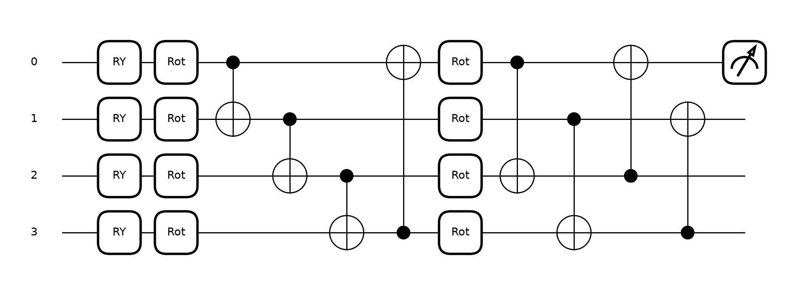
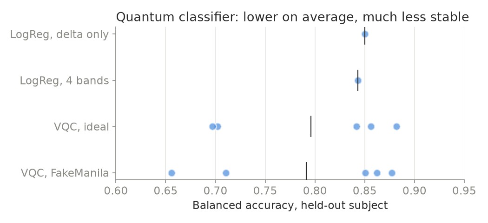
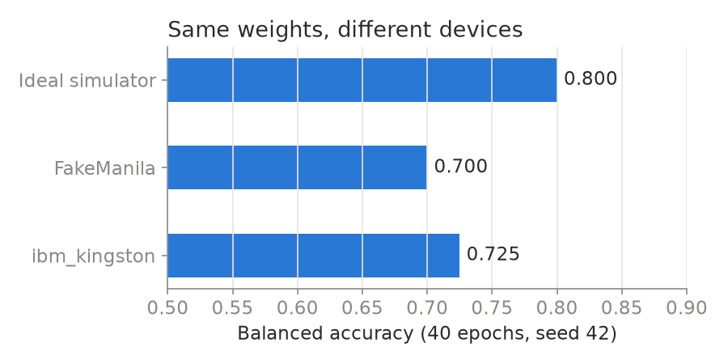

# quantum-sleep

A small experiment: can a 4-qubit variational quantum classifier separate N2 from N3 sleep using EEG band powers, and how does it compare to a classical baseline?

Built in one day as a first hands-on exploration of quantum machine learning. The goal was not to beat classical ML but to build the full hybrid pipeline, evaluate it honestly, and run it on real quantum hardware.

## TL;DR

- A logistic regression on a single feature (delta power) reaches **0.850** balanced accuracy on an unseen subject.
- The quantum classifier reaches **0.796 ± 0.080** over 5 seeds in an ideal simulator: lower on average and much less stable.
- On real hardware (**ibm_kingston**) accuracy drops further due to noise (0.800 ideal vs 0.725 real on the same 40-epoch subset).
- Conclusion: on this problem quantum gives no advantage. The task is close to one-dimensional, the classical loss is convex, and the quantum loss landscape is not.

## Data

- **Dataset:** ISRUC-Sleep, 3 subjects (1,2,3), scorer 1 labels
- **Channel:** C4-A1, 200 Hz, 30-second epochs (AASM scoring)
- **Task:** binary, N2 (0) vs N3 (1)
- **Split:** by subject, 2 subjects for training (1,2), 1 held-out subject for testing, so no epochs of the test night are seen during training
  - Train: 539 N2 / 388 N3
  - Test: 246 N2 / 173 N3
- **Metric:** balanced accuracy (classes are imbalanced)

## Features

Per 30-second epoch, 4 numbers: the log of the mean power spectral density (Welch, 4-second windows) in each band.

| Band | Range (Hz) | Why |
|---|---|---|
| Delta | 0.5–4 | slow waves, the defining marker of N3 |
| Theta | 4–8 | N1 / REM |
| Alpha | 8–12 | relaxed wakefulness |
| Sigma | 11–16 | sleep spindles, a marker of N2 |

The log compresses outliers and turns multiplicative differences into additive shifts. Mean values on one subject confirm the physiology: N3 has about 2.4x more delta power than N2, and N2 has slightly more sigma power.

Features are scaled to [0, π] with a MinMaxScaler fit on the training set only. Test values are clipped to the same range. The range [0, π] is chosen because each feature becomes a rotation angle, and on [0, π] the mapping from angle to measurement probability is monotonic.

## Models

**Classical baseline:** scikit-learn logistic regression, on all 4 features and on delta alone.

**Variational quantum classifier (PennyLane):**
1. `AngleEmbedding` (RY): feature i rotates qubit i
2. `StronglyEntanglingLayers`, 2 layers: per-qubit trainable rotations plus a ring of CNOTs that entangles the qubits (24 trainable weights)
3. Readout: expectation value of Pauli-Z on qubit 0, in [-1, 1], plus a trainable bias
4. Loss: mean squared error against targets N2 = -1, N3 = +1. Prediction: N3 if output > 0
5. Training: Adam (lr 0.05), 100 steps, mini-batches of 64, on the `default.qubit` simulator (gradients via backprop)

**Hardware evaluation:** the model is trained once in the ideal simulator, then the same weights are evaluated on
- `FakeManilaV2`: a local noise model of a 5-qubit IBM device, 1000 shots
- `ibm_kingston`: real IBM quantum hardware via the IBM Quantum Open Plan, 1000 shots

Training directly on hardware was not attempted: gradients there require the parameter-shift rule, i.e. thousands of noisy circuit runs per step.



## Results

**Full test set (419 epochs, held-out subject)**

| Model | Features | Balanced accuracy |
|---|---|---|
| Logistic regression | delta only | 0.850 |
| Logistic regression | 4 bands | 0.843 |
| VQC, ideal simulator, 5 seeds | 4 bands | 0.796 ± 0.080 |
| VQC, FakeManilaV2, 5 seeds | 4 bands | 0.791 ± 0.008 |

Runs for ideal simulator (0.856, 0.882, 0.702, 0.842, 0.697)
Results for FakeManila (0.862, 0.877, 0.655, 0.850, 0.710)



**Same trained model (seed 42) on a fixed, class-balanced subset of 40 test epochs (20 N2, 20 N3)**

| Device | Balanced accuracy |
|---|---|
| Ideal simulator | 0.800 |
| FakeManilaV2 (noise model) | 0.700 |
| ibm_kingston (real hardware) | 0.725 |



## Findings

1. **The problem is nearly one-dimensional.** Delta power alone matches all 4 features. No model, quantum or classical, has much room to show an advantage here.
2. **The quantum model is harder to train.** Logistic regression has a convex loss and gives the same result every time. The VQC loss landscape is non-convex and periodic, so the outcome depends on initialization: 3 of 5 seeds land in the mid-80s, 2 drop to about 70%.
3. **Hardware noise costs accuracy.** Noise pulls the output towards 0, so epochs near the decision boundary flip. On the 40-epoch subset this cost about 3 epochs (8 points). The fake and real results differ by one epoch, which is within noise.

## Limitations

- Only 3 subjects and a single test subject. Results would need leave-one-subject-out evaluation on more subjects to be robust.
- The real-hardware result is based on 40 epochs, so each epoch moves the score by 2.5 points.
- Band powers averaged over 30 seconds only approximate the AASM scoring rules (amplitude thresholds, durations, context from neighbouring epochs).
- No hyperparameter tuning. The test set was not used to choose any setting.

## Next steps

- Initialization near identity (small random weights) to test whether training becomes more stable
- Data re-uploading (encoding the features multiple times between layers) for more expressive circuits
- Leave-one-subject-out over more ISRUC subjects
- Comparing hardware: IBM chips connect only neighbouring qubits, so the CNOT ring needs extra SWAP gates. Trapped-ion hardware (e.g. IonQ) has all-to-all connectivity and would avoid them

## How to run

```bash
uv sync
```

For real IBM hardware, create a `.env` file (never commit it):

```
ibm=your_api_key
crn=your_instance_crn
```

Data: ISRUC-Sleep is available from https://sleeptight.isr.uc.pt/. Place the `.edf` recordings and `_1.txt` label files under `data/`.

## Stack

Python 3.12, uv, PennyLane, pennylane-qiskit, qiskit-ibm-runtime, qiskit-aer, MNE, SciPy, scikit-learn
